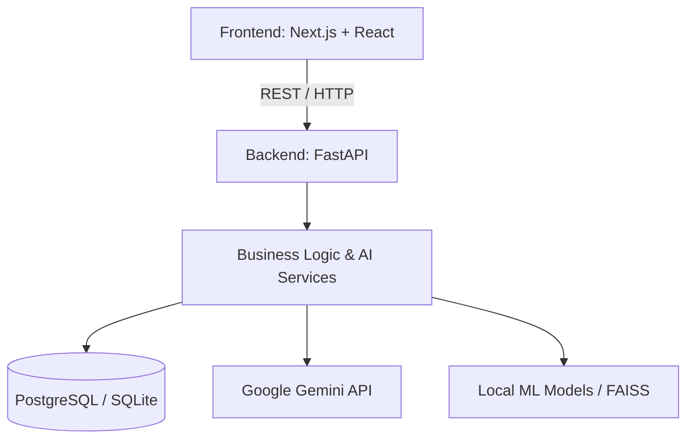
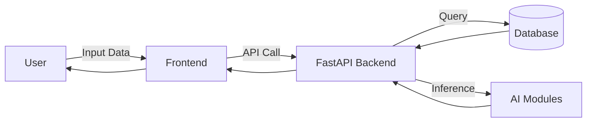
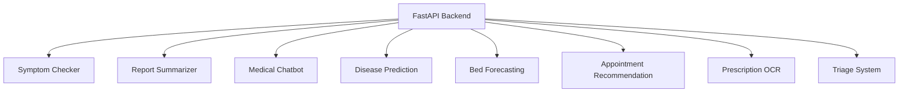
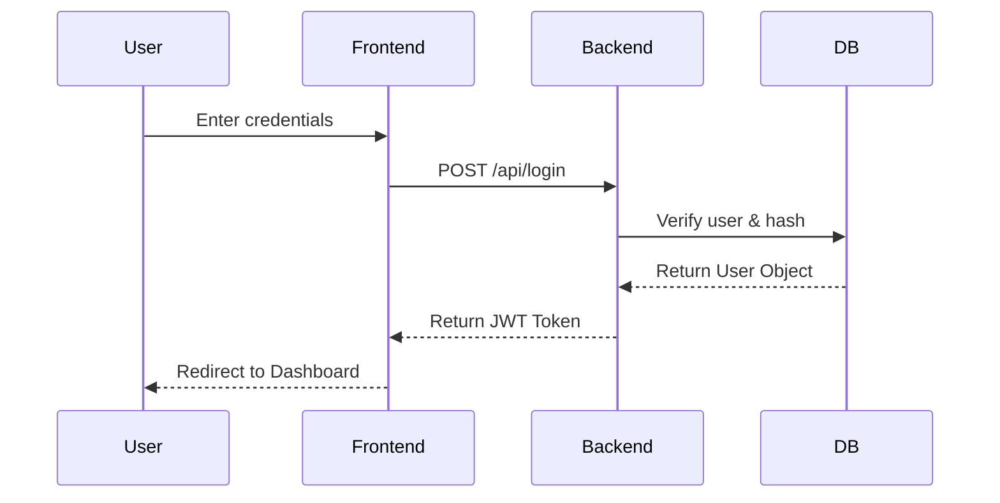
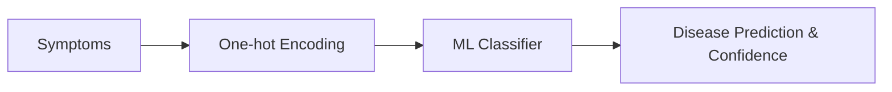
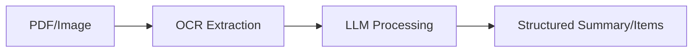
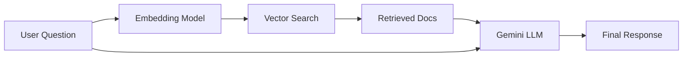
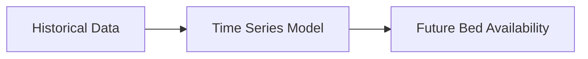
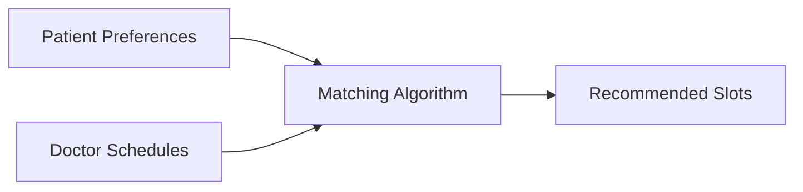
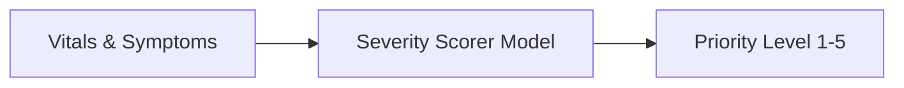

# Architecture

## High-Level System Architecture

## Data Flow Diagram

## AI Modules Interaction

## Authentication Flow

## AI Module Pipeline Flows

### 1. Symptom Checker & 4. Disease Prediction

### 2. Medical Report Summarizer & 7. Prescription OCR

### 3. Medical Chatbot (RAG)

### 5. Bed Occupancy Forecasting

### 6. Appointment Recommendation

### 8. Triage System

